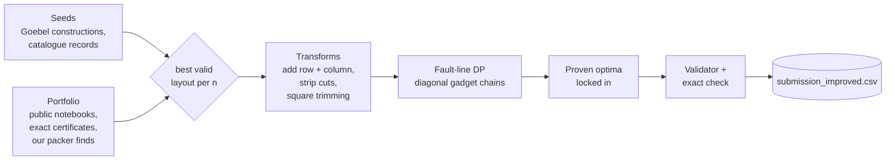

# Squares in Squares

Packings of *n* unit squares into the smallest possible square, for every
*n* from 1 to 1000. This is the code behind our entry in the Kaggle
[Squares in Squares](https://www.kaggle.com/competitions/squares-in-squares)
competition.

<p align="center">
  <b>Public score 22.2557026</b> &nbsp;·&nbsp; 547 layouts that beat the grid &nbsp;·&nbsp; 122 proven optima locked
</p>

> Русская версия с полным журналом экспериментов: [README.ru.md](README.ru.md).

---

## The problem

For each *n*, place *n* non-overlapping unit squares (any position, any
rotation) inside a square of side *L*. The score is

$$\text{score} = \sum_{n=1}^{1000} \left( \frac{L(n)}{\sqrt{n}} - 1 \right)$$

Lower is better. The trivial grid uses $L = \lceil \sqrt{n} \rceil$, so a
perfect square *n* = *k²* costs nothing. Everything just above a perfect
square is expensive. The gains come from tilted squares that pack the
"leftover" rows more tightly than the grid can.

## Quick start

```bash
python3 packing_solution.py
```

This builds `submission_improved.csv`, checks every layout and prints the
local Kaggle score. It needs only the Python standard library. It needs no
network and no solver. The bundled snapshots in `published_sources/` hold
everything the build uses.

Run the tests:

```bash
python3 -m pytest -q test_*.py
```

Before submitting, run the overlap check that sees the file as Kaggle does
(see [Exact certification](#exact-certification)):

```bash
python3 exact_overlap.py submission_improved.csv
```

## How the solution is built



1. **Seeds.** These are the classical Goebel constructions for 5, 27 and 52
   squares, plus 45 dense records from the
   [Squares in Squares catalogue](https://kingbird.myphotos.cc/packing/squares_in_squares.html)
   and [Ryan Xu's collection](https://github.com/ry-xu/square_packing). They
   live in `record_seeds.json`.
2. **Portfolio.** These are validated layouts from public notebooks, exact
   rational certificates and the finds of our own searches. For every *n*
   the build keeps the strictly smallest side and keeps the original
   decimal text.
3. **Transforms.** A layout for *n* yields layouts for its neighbours in
   three ways:
   - add an outer row and column;
   - cut out a unit-wide strip and close the gap;
   - remove up to four boundary squares, trying eight directions.
4. **Fault-line DP** ([fault_line_dp.py](fault_line_dp.py)) is the main
   engine for large *n*.
   - It crops rectangular gadgets from every donor layout, in eight
     symmetries.
   - A gadget of size *w*×*h* holds *w·h + d* squares in a box of at most
     (*w+f*)×(*h+f*).
   - A minimax dynamic program chains gadgets along the diagonal so that
     their widths and heights add up. It keeps the largest overhang *f* as
     small as possible.
   - Grid blocks fill the rest.
   - Superseded donors stay in the pool, so a better layout for one *n*
     never removes a gadget that another *n* depended on.
5. **Proven optima** ([optimal_locks.py](optimal_locks.py)) replace any
   candidate. These are the perfect squares, the *k²−1* family, classical
   small cases and the computer-proved *k²−3* and *k²−4* families.
   [locked_optimal.csv](locked_optimal.csv) lists each one with its proof
   source.
6. **Validation.** [validate_submission.py](validate_submission.py) checks
   counts, finiteness and overlaps with the separating-axis test, then
   measures each side. [exact_overlap.py](exact_overlap.py) repeats the
   overlap test in 45-digit decimals.

## Searching for better gadgets

The DP can only be as good as its gadgets. Most recent gains came from
improving a single **bottleneck gadget**: the one whose overhang sets *L*
for a given *n*.

- **Bottleneck hops.** We recompose *n*'s DP chain at a slightly smaller
  side.
  - We free only the bottleneck gadget and a one-unit ring around it; every
    other square stays frozen.
  - We then run Evan Daniel's
    [packer](https://github.com/evand/square-packing) `hop` search on
    Kaggle CPU kernels.
  - Steps of about 0.001–0.004 in side length succeed regularly. Jumping
    straight to the leader's side has never worked.
  - The finds are in `published_sources/packer_*.csv.gz`. The kernel code
    is not in this repository.
- **Gadget polishing.** These scripts improve the gadgets themselves:
  - [search_gadget.py](search_gadget.py) and
    [core_refill_search.py](core_refill_search.py) re-pack a gadget's
    tilted core;
  - an LP restores feasibility;
  - a MILP refills the upright squares;
  - [joint_polish.py](joint_polish.py) polishes positions and free angles
    together.

  Results go to `gadget_overrides.json`.
- **Pair search.** [rectangle_pair_search.py](rectangle_pair_search.py)
  tries gadget pairs that the DP rejects because of an occupied corner.
  When needed, it nudges the second gadget along the diagonal.

### What did not work

Each of the following has a script and a report in `reports/`. None of them
produced a valid denser layout:

| Approach | Script | Outcome |
|---|---|---|
| Global soft-overlap search, basin hopping | `soft_global_search.py` | n=147 never reached even the known layout |
| GPU soft search with neighbour lists, LNS | `gpu_soft_search.py` | no feasible denser layout on 13 targets |
| Insert-and-relax from a smaller *n* | `insert_relax_search.py` | overlap energy stuck ≥ 4 on n=911 |
| V-band seeds + MILP | `v_band_seed_search.py` | 21-square capacity gap on n=498 |
| Staircase soft search with inflation | `staircase_soft_search.py` | no strict restoration |
| Full-layout basin hopping | `full_layout_basin_search.py` | new contact graphs, same sides |
| Remove one square from *n+1*, then LP | `neighbor_transfer_lp.py` | no gain on 20 sizes |

The lesson: layouts at this density are reachable only from an almost
correct structure. Better *structures* (gadgets) pay off. More random
search does not.

## Exact certification

The Kaggle metric checks overlaps with interval arithmetic on the text it
receives. So two squares that touch with a 1e-16 overlap fail there, even
though a `float` validator accepts them.

There is a second trap. Kaggle reads the CSV into **float64** pandas
columns and writes it back to text *before* it runs the check. Digits
beyond double precision are thrown away. A 45-digit layout separated by
1e-30 turns into an overlapping one.

`exact_overlap.py` copies this behaviour: it rounds every value through
`float`, then runs the separating-axis test in 45-digit decimals. Exact
certificates are imported with contacts scaled apart by 1 + 1e-12, which is
enough to survive float64 rounding.

## Sources and credits

All imported layouts are listed with their URL, snapshot date and SHA-256
in [published_sources/README.md](published_sources/README.md). They come
from the following sources:

- **Public Kaggle notebooks:**
  - [ntumlnoob](https://www.kaggle.com/code/ntumlnoob/22-264-with-rectangles-ftmc-milp-fq-cpu-gpu),
    which is our base portfolio;
  - [alexchilton](https://www.kaggle.com/code/alexchilton/fault-line-dp-basin-hopping-lb-22-2672);
  - [malyshevdanil](https://www.kaggle.com/code/malyshevdanil/squares-in-squares-neighbour-transfer-squeeze);
  - busyaprime, prvsiyan, sigmaborov and nilanjansaha123, which come in
    through [auto_import_public.py](auto_import_public.py);
  - the [per-puzzle leaderboard](https://www.kaggle.com/code/inversion/squares-in-squares-per-puzzle-leaderboard)
    by inversion, used for target selection only.
- **Exact certificates:**
  - [Francisco Couzo](https://github.com/franciscouzo/square-packing);
  - [Evan Daniel](https://github.com/evand/square-packing) (MIT), whose
    packer we also use for hops.
- **Records:**
  - the [Squares in Squares catalogue](https://kingbird.myphotos.cc/packing/squares_in_squares.html);
  - [Ryan Xu](https://github.com/ry-xu/square_packing).

## Score history

| Score | Change |
|---:|---|
| 24.2803 | own constructions only (`--no-public-portfolio --no-fault-dp`) |
| 22.2687 | public portfolio + fault-line DP |
| 22.2624 | newer public snapshots |
| 22.2594 | Couzo certificates, packer basin hopping, auto-imports |
| 22.2582 | bottleneck hops, round 1 |
| 22.2577 | round 2 + two public notebooks |
| 22.2569 | Evan Daniel certificates, float64-safe text |
| **22.2557** | bottleneck hops, round 3 |

## Repository map

| Path | What it is |
|---|---|
| `packing_solution.py` | main build; `--portfolio extra.csv` adds layouts, `--no-fault-dp` / `--no-public-portfolio` for ablation |
| `fault_line_dp.py` | gadget extraction and diagonal minimax DP |
| `validate_submission.py` | validator and local scorer (`--report`, `--allow-partial`) |
| `exact_overlap.py` | float64-aware 45-digit overlap check |
| `optimal_locks.py`, `locked_optimal.csv` | proven optima |
| `auto_import_public.py` | pull strictly better layouts from top public notebooks (needs the `kaggle` CLI) |
| `import_published_packings.py` | re-import catalogue and Ryan Xu records |
| `area_gap_report.py`, `plateau_report.py` | pick the next targets |
| `report_fault_line.py` | which gadgets the final layouts use |
| `published_sources/` | compressed layout snapshots with provenance |
| `reports/` | JSON/Markdown logs of every search run |
| `test_*.py` | test suite |
